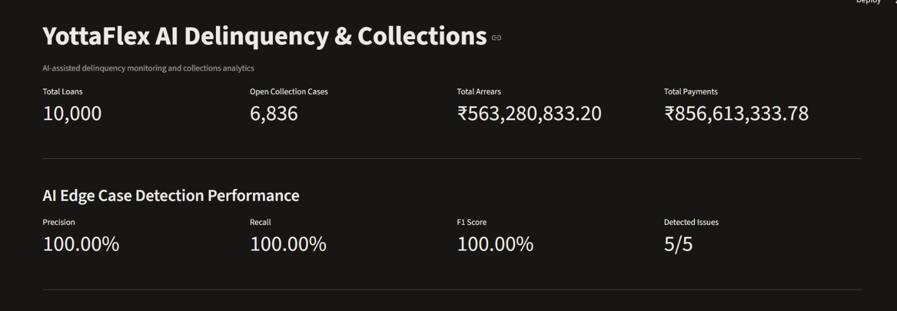

# YottaFlex AI Delinquency & Collections Management System

**AI-assisted delinquency monitoring and collections analytics**

An end-to-end Python project that generates synthetic loan and repayment data, monitors overdue accounts, prioritizes collection cases, detects data-quality and compliance issues, and presents collection analytics through an interactive Streamlit dashboard.

## 1. Project Overview

Financial institutions need to identify overdue accounts, understand repayment behaviour, prioritize collection activities, and monitor contact compliance.

This project demonstrates a data-driven collections management system using synthetic financial data. It generates loan and installment records, calculates delinquency information, creates collection cases, detects deliberately injected edge cases, and displays analytics in a dashboard.

## 2. Key Features

- Synthetic generation of 10,000 loans and 30,000 installments.
- Customer, account, loan, installment, and delinquency management.
- Collection case creation and priority scoring.
- Contact preferences and contact attempt tracking.
- Promise-to-pay and payment monitoring.
- Delinquency and arrears calculations.
- Detection of five deliberately injected edge cases.
- Ground-truth evaluation with precision, recall, and F1 score.
- CSV, JSON, and SQL data exports.
- Data validation and export verification.
- Interactive Streamlit dashboard.
- Search and filter collection cases.
- Deterministic data generation using a fixed random seed.

## 3. Technology Stack

| Technology | Purpose |
|---|---|
| Python | Core programming language |
| SQLite | Database |
| SQLAlchemy | Database models and operations |
| Pandas | Data processing and exports |
| NumPy | Numerical operations |
| Faker | Synthetic data generation |
| Streamlit | Interactive dashboard |
| Plotly | Dashboard charts |
| Pytest | Automated testing |

## 4. Dataset Details

The full-scale synthetic dataset contains:

| Entity | Records |
|---|---:|
| Customers | 10,000 |
| Accounts | 10,000 |
| Loans | 10,000 |
| Installments | 30,000 |
| Delinquency Snapshots | 10,000 |
| Contact Preferences | 30,000 |
| Collection Cases | 6,836 |
| Contact Attempts | 6,155 |
| Promises to Pay | 1,996 |
| Payments | 17,925 |

All records are synthetic and do not contain real customer financial information.

**Random seed:** `20261022`

**As-of date:** `2026-10-22`

## 5. Edge Case Detection

Five labelled edge cases are deliberately injected after generating the valid baseline dataset.

1. Paid account remains in collection.
2. Contact attempt outside the allowed contact window.
3. Payment allocated to the wrong installment.
4. Promise amount exceeds arrears.
5. Disputed debt treated as confirmed.

The detection system identifies these cases and compares its results against a separate ground-truth file.

### Evaluation Results

| Metric | Result |
|---|---:|
| Expected cases | 5 |
| Detected cases | 5 |
| True positives | 5 |
| False positives | 0 |
| False negatives | 0 |
| Precision | 100% |
| Recall | 100% |
| F1 Score | 100% |

**Important:** These evaluation results apply to the five deliberately injected test cases. They do not represent proven performance on real-world collections data.

## 6. Project Structure

```text
YottaFlex-AI-Delinquency-Collections-Management/
│
├── config.py
├── main.py
├── requirements.txt
├── README.md
│
├── dashboard/
│   └── app.py
│
├── data/
│   ├── raw/
│   ├── processed/
│   └── ground_truth/
│
├── docs/
│   ├── DATA_DICTIONARY.md
│   ├── DATABASE_SCHEMA.md
│   ├── DESIGN_DECISIONS.md
│   └── AI_USAGE.md
│
├── prompts/
│   └── PROMPT_HISTORY.md
│
├── src/
│   ├── generators/
│   ├── models/
│   ├── services/
│   └── validation/
│
└── tests/
    └── test_evaluation.py
```

## 7. Installation

### Step 1: Clone the repository

```bash
git clone https://github.com/SaiKiranGandham/YottaFlex-AI-Delinquency-Collections-Management.git
```

Replace `YOUR_USERNAME` with your GitHub username.

### Step 2: Open the project directory

```bash
cd YottaFlex-AI-Delinquency-Collections-Management
```

### Step 3: Create a virtual environment

```bash
python -m venv venv
```

Activate it on Windows PowerShell:

```powershell
.\venv\Scripts\Activate.ps1
```

### Step 4: Install dependencies

```bash
pip install -r requirements.txt
```

## 8. Run the Project

### Generate the full dataset

```bash
python main.py --scale full
```

For a smaller starter dataset:

```bash
python main.py --scale starter
```

**Note:** Running the generator recreates the database. It removes previously injected edge cases, so rerun the edge-case pipeline after regenerating.

### Inject edge cases

```bash
python -m src.validation.edge_case_injector
```

### Detect edge cases

```bash
python -m src.validation.edge_case_detector
```

### Evaluate detection results

```bash
python -m src.validation.evaluation
```

### Validate generated data

```bash
python -m src.validation.data_validator
```

### Export data

```bash
python -m src.services.export_service
```

### Verify exports

```bash
python -m src.services.verify_export
```

### Run automated tests

```bash
python -m pytest -v
```

### Launch the dashboard

```bash
streamlit run dashboard/app.py
```

Open the local URL displayed in your terminal, usually:

`http://localhost:8501`

## 9. Dashboard

The Streamlit dashboard provides:

- Total loan count.
- Open collection cases.
- Total arrears and payments.
- AI edge-case detection performance.
- Delinquency risk distribution.
- Collection priority queue.
- Risk category filtering.
- Loan ID and case ID search.
- CSV download of filtered collection cases.
- Payment status and promise-to-pay summaries.

### Dashboard Screenshot

## 📸 Dashboard Screenshots

### Dashboard Overview


### Dashboard Screenshot 2


### Dashboard Screenshot 3


### Dashboard Screenshot 4


## 10. Data Exports

Generated outputs are stored in the `data/` directory.

- `data/raw/` — CSV and JSON exports and SQL seed data.
- `data/processed/` — detection results and evaluation reports.
- `data/ground_truth/` — labelled edge-case ground truth.

Ground truth is kept separate from the detection process and is used for evaluation.

## 11. Reproducibility

The project uses a fixed random seed:

`20261022`

The reproducibility check regenerates the starter dataset twice and compares SHA-256 checksums of the generated files.

The starter-scale reproducibility check passed with matching checksums.

## 12. Design and AI Usage

The project includes documentation describing:

- Database design and relationships.
- Data dictionary and field definitions.
- Technical decisions and trade-offs.
- AI-assisted development and prompt history.
- Validation, testing, and project limitations.

AI assistance was used to accelerate development and debugging. Generated code and outputs were reviewed and tested as part of the implementation.

## 13. Limitations

- The dataset is synthetic and does not represent real customer behaviour.
- The five edge cases are intentionally injected test scenarios.
- The evaluation metrics measure detection of those five scenarios only.
- Priority scores are project-defined and are not a production credit-risk model.
- The project is a demonstration and requires additional legal, security, operational, and model validation before real financial deployment.

## 14. Future Improvements

- Add configurable collection scheduling and follow-up tasks.
- Improve risk scoring with validated machine-learning models.
- Add more automated tests and edge-case scenarios.
- Introduce authentication and role-based access.
- Add production database and deployment support.
- Improve monitoring and audit reporting.

## 15. Author

**Sai Kiran Gandham**

GitHub: https://github.com/SaiKiranGandham

LinkedIn: https://www.linkedin.com/in/sai-kiran-gandham-84a0b3248

Portfolio: https://sai-kiran-portfolio-one.vercel.app

---

**Project:** YottaFlex AI Delinquency & Collections Management System

**Purpose:** AI-assisted delinquency monitoring, collection prioritization, and analytics.